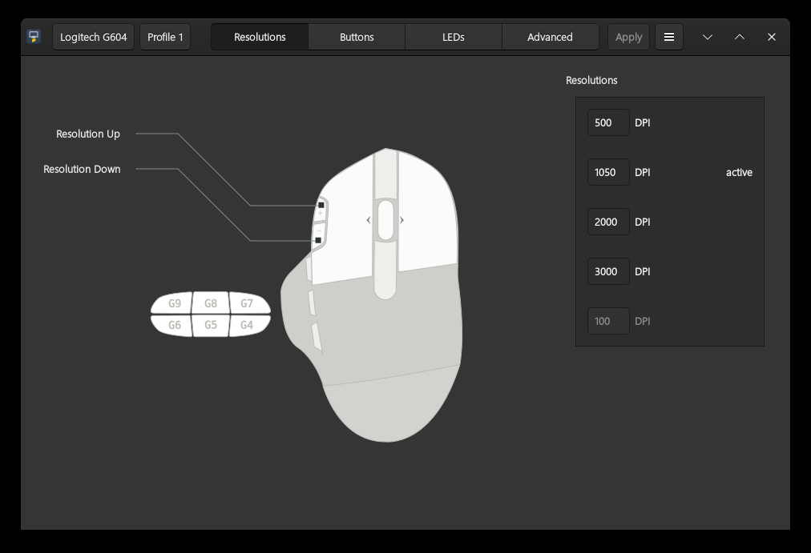
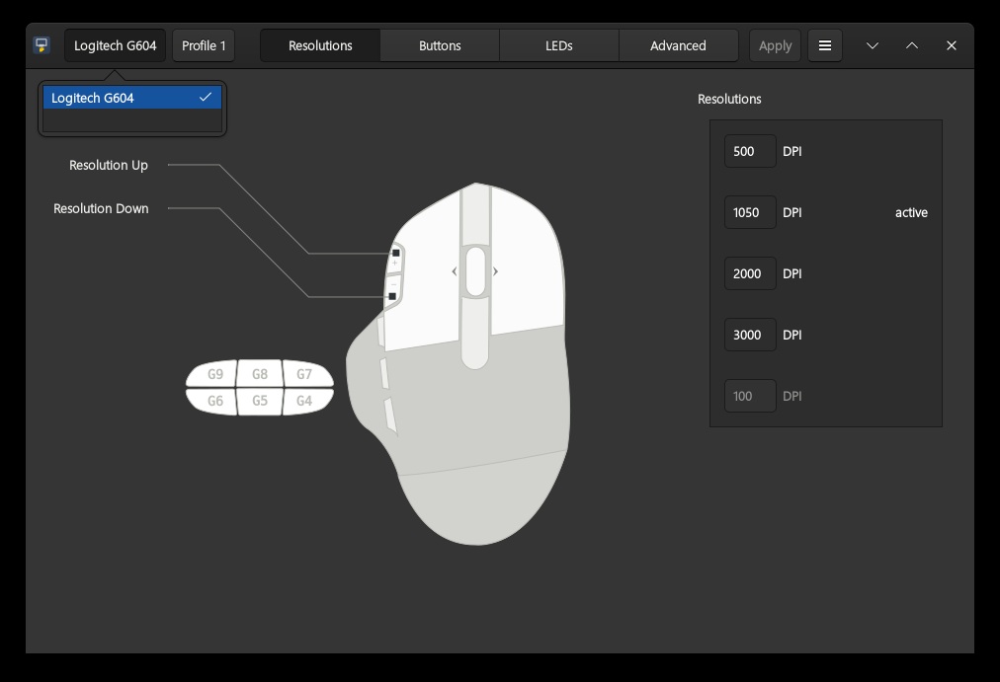
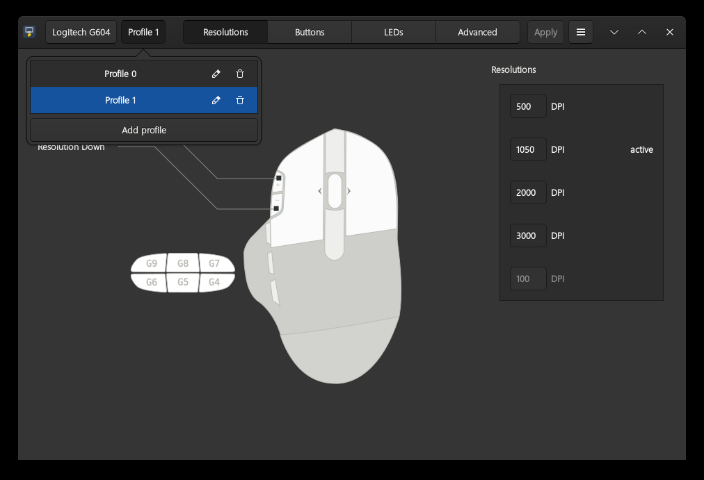
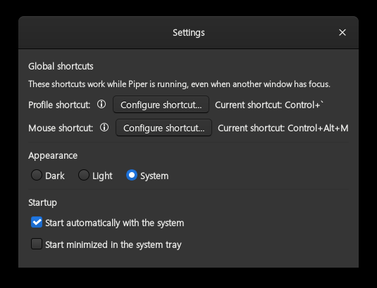
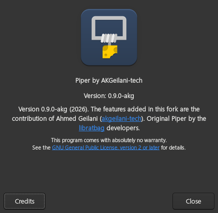

Piper by AKGeilani-tech
=======================

**Piper by AKGeilani-tech** is a fork of [Piper](https://github.com/libratbag/piper),
the GTK+ frontend for configuring gaming mice through libratbag's `ratbagd`
D-Bus daemon. This fork is maintained by
[Ahmed Geilani (@akgeilani-tech)](https://github.com/akgeilani-tech).

The current release is **0.9.1-akg**. It is an independent fork version:
future releases use `0.9.2-akg`, `0.9.3-akg`, and so on, so they cannot
be confused with the official Piper version.

[Download the latest release](https://github.com/akgeilani-tech/piper/releases/latest)

What's new in the 0.9 series
=======================

### Added

- **Settings dialog** with a global shortcut to switch the selected mouse to
  its next enabled profile, even while another window has focus.
- **Mouse selector** to the left of *Profile*, with the model name reported by
  `ratbagd`, persistent selection, hotplug detection and clear
  *Mouse not supported* / *Mouse not available* states.
- **Second global shortcut** to switch between compatible mice.
- **Appearance settings**: Dark, Light and System color modes, with
  Breeze/Breeze-Dark support and live system color changes.
- **Startup settings**: start with the session and/or start minimized in the
  system tray.
- **System tray icon** with a DBusMenu: *Show Piper*, *Settings* and *Quit*.
- **Quit entry** after *About Piper*; it closes the app and tray icon for the
  current session without changing saved settings.
- **Persistent profile names** with inline renaming. Names are stored in
  `settings.ini` because many devices ignore `ratbagd`'s writable `Name`.
- **English and Spanish** translation profiles, with the complete interface
  translated.
- **Partial-support warning**: devices that expose settings but cannot persist
  them (for example the Logitech G602 with libratbag 0.18) show a warning and
  disable *Apply* instead of pretending to save.

### Fixed

- ratbagd exits after 20 minutes of inactivity. Piper now keeps it alive while
  running and reconnects automatically if it disappears.
- Switching the selected mouse no longer mixes profiles from another device.
- The active profile cannot be deleted, and profile operations respect
  `CAP_DISABLE` and report D-Bus errors.
- Flatpak no longer loads a stale `Locale` extension, and templates no longer
  fall back to English.
- KDE `ConfigureShortcuts` v2 now falls back to the v1 bind path when the
  portal does not implement it.
- Autostart uses the correct Flatpak/native command and respects
  `XDG_CONFIG_HOME`.
- `Escape` closes Settings, and shortcut help/value controls have accessible
  names and tooltips.
- Several crashes and stale D-Bus/GTK interactions found during real-device
  validation were fixed.

Screenshots
===========











Supported devices
=================

Piper is only a frontend. The list of supported devices comes from
[libratbag](https://github.com/libratbag/libratbag/tree/master/data/devices).
Device protocols usually have to be reverse-engineered, and the available
features may differ from the manufacturer's advertised features.

With libratbag 0.18, some devices (notably the Logitech G602) are detected but
cannot persist changes. Piper warns about this and disables *Apply* for them;
the actual fix must come from libratbag.

Installing Piper by AKGeilani-tech
==================================

The Flatpak contains Piper, **not** `ratbagd`. Install libratbag/ratbagd on the
host first; Piper talks to it over the system D-Bus.

### 1. Install libratbag manually

**Fedora**

```sh
sudo dnf install libratbag-ratbagd
sudo systemctl enable --now ratbagd
```

**Arch Linux**

```sh
sudo pacman -S libratbag
sudo systemctl enable --now ratbagd
```

**Debian / Ubuntu**

```sh
sudo apt install ratbagd
sudo systemctl enable --now ratbagd
```

Verify that the daemon sees your mouse:

```sh
ratbagctl list
```

If `ratbagctl` does not exist, install the tools package for your distribution
or use `gdbus` to query `org.freedesktop.ratbag1`.

### 2. Install the Flatpak from Releases

Download
[the latest release](https://github.com/akgeilani-tech/piper/releases/latest)
and install the `.flatpak` bundle. The application needs the GNOME 50 runtime:

```sh
flatpak remote-add --if-not-exists flathub https://flathub.org/repo/flathub.flatpakrepo
flatpak install --user flathub org.gnome.Platform//50
flatpak install --user ./org.freedesktop.Piper-0.9.1-akg-amd64.flatpak
flatpak run org.freedesktop.Piper
```

The Flatpak keeps the application ID `org.freedesktop.Piper`, so existing
Piper settings, autostart entries and shortcuts continue to work.

### Uninstall

```sh
flatpak uninstall --user org.freedesktop.Piper
```

Building from git
=================

Piper uses the Meson build system:

```sh
git clone https://github.com/akgeilani-tech/piper.git
cd piper
meson setup builddir --prefix=/usr/
ninja -C builddir
```

To install:

```sh
sudo ninja -C builddir install
```

At runtime Piper needs GTK 3.22+, librsvg 2, PyGObject, `lxml`, `evdev` and
`pycairo`. On Debian/Ubuntu the typelibs are in `gir1.2-gtk-3.0` and
`gir1.2-rsvg-2.0`.

For development, `piper.devel` uses the data files from the source tree:

```sh
ninja -C builddir
./builddir/piper.devel
```

This still requires ratbagd on the system bus.

Troubleshooting
===============

- **No devices / connection error:** check `systemctl status ratbagd` and
  `ratbagctl list`.
- **Piper loses the connection after being idle:** ratbagd exits after 20
  minutes without D-Bus activity. This fork pings it every 10 minutes and
  reconnects automatically; if the problem persists, restart `ratbagd`.
- **A mouse appears but changes are not saved:** the device may have partial
  libratbag support. Piper shows a warning and disables *Apply*.
- **No tray icon in KDE:** make sure the status notifier watcher is available.
  Piper retries at login; check `busctl --user list | grep StatusNotifier`.

Contributing
============

Bug reports and pull requests are welcome at
[akgeilani-tech/piper](https://github.com/akgeilani-tech/piper/issues). Device
support itself belongs to libratbag; reports about a model should include its
USB vendor/product ID and the output of `ratbagctl list`.

Piper follows Python's PEP8 style with `black`; tests include formatting
checks:

```sh
meson test -C builddir
```

Credits
=======

- Fork maintained by [Ahmed Geilani (@akgeilani-tech)](https://github.com/akgeilani-tech).
- Original Piper created by the [libratbag developers](https://github.com/libratbag/piper).
- All upstream copyright notices and the GPL license are preserved.

Source
======

```sh
git clone https://github.com/akgeilani-tech/piper.git
```

Bugs
====

Report bugs at <https://github.com/akgeilani-tech/piper/issues>.

License
=======

Licensed under the GNU General Public License v2.0 or later. See the
[COPYING](COPYING) file for the full license text.
